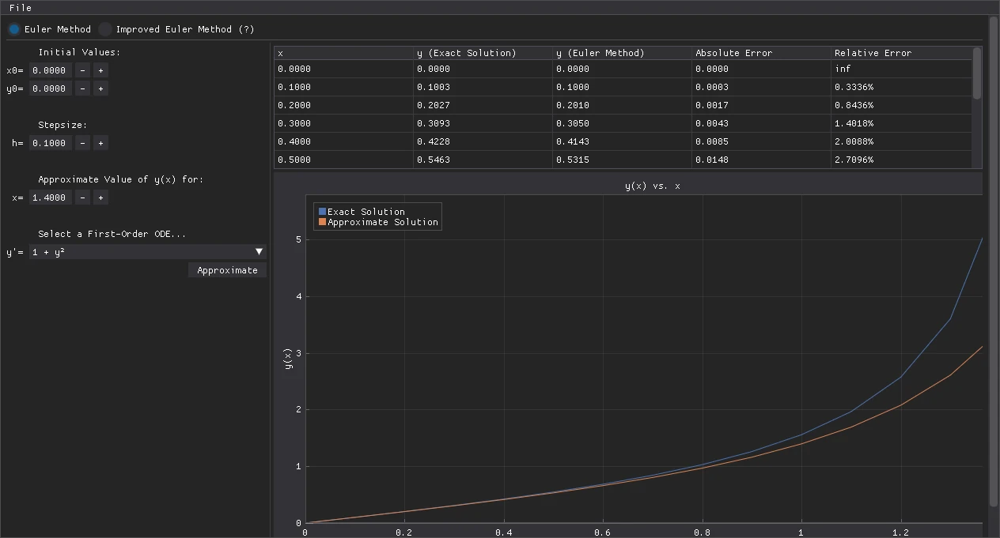
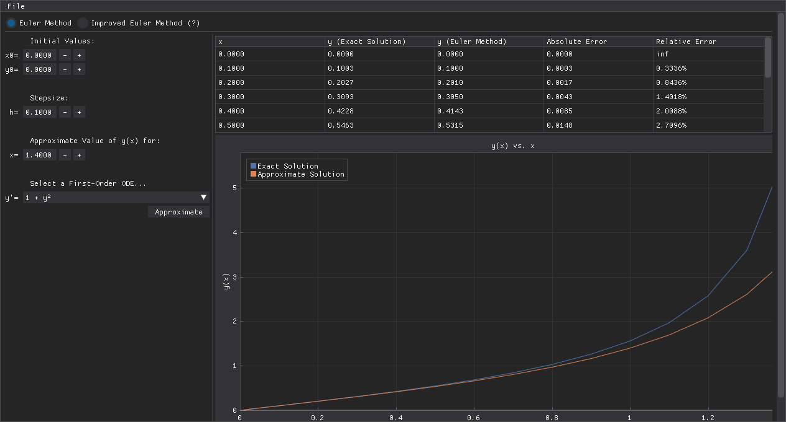
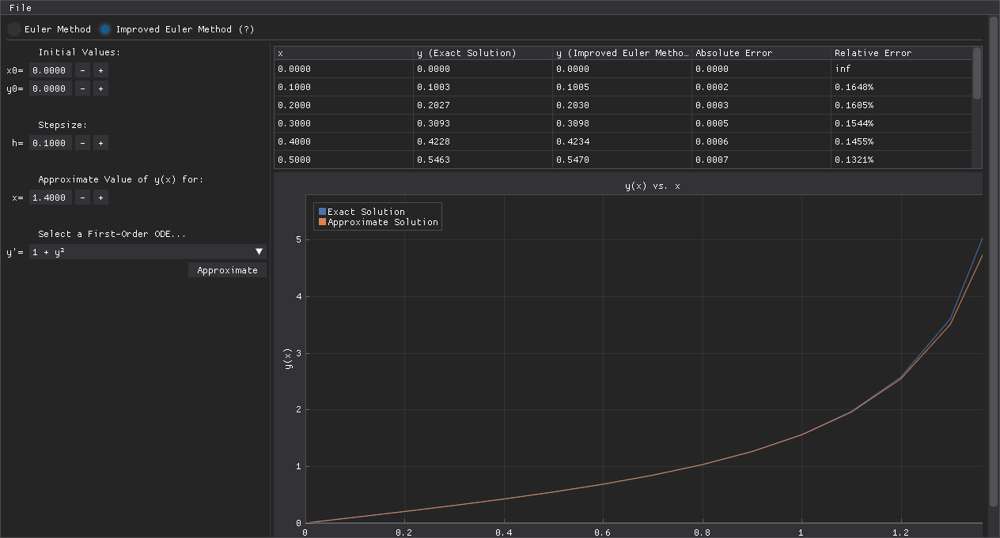

<h1 align="center">Euler Method Explorer</h1>

<p align="center">
  <strong>See how well simple step-by-step methods approximate a differential equation.</strong><br>
  Pick an equation, a starting point and a step size: the app solves it two ways and shows, row by row and on a graph, how far each answer is from the exact one.
</p>

<p align="center">
  
</p>

<p align="center">
  <sub>y' = 1 + y² from (0, 0) with step 0.1. Plain Euler falls far behind as the curve steepens; the improved method stays close to it.</sub>
</p>

---

## What it does

- **Two methods side by side.** Solve with the Euler method or the improved Euler method (also called Heun's method) and switch between them with one click.
- **Every step shown.** A table lists x, the exact value, the approximation, and the absolute and relative error at each step.
- **Graph of exact vs. approximate.** Both curves are plotted together, so the error is visible at a glance.
- **Six equations built in**, each with its exact solution:

  | | | |
  | :--- | :--- | :--- |
  | y' = e^(2y) | y' = (x + y − 5)² | y' = 0.9y − 1.8y² |
  | y' = 2xy | y' = 1 + y² | y' = xy + √y |

- **Export to CSV** from **File → Export Table as .CSV**.
- **Hover the (?)** next to the method buttons to see the formulas.

---

## Screenshots

<table>
  <tr>
    <td width="50%" valign="top">
      
      <br><sub><b>Euler method.</b> At x = 1.4 it reaches 3.39 against an exact 5.80.</sub>
    </td>
    <td width="50%" valign="top">
      
      <br><sub><b>Improved Euler.</b> Same equation and step: errors stay under 0.2 % for the first half.</sub>
    </td>
  </tr>
</table>

---

## How it works

Both methods start at the point you give and walk toward the target x in steps of size h:

- **Euler:** take the slope where you are and follow it for one step.
  y₍ᵢ₊₁₎ = yᵢ + h · f(xᵢ, yᵢ)
- **Improved Euler:** take the slope where you are, peek at the slope where that step would land, and follow their average.
  k₁ = f(xᵢ, yᵢ), k₂ = f(xᵢ + h, yᵢ + h·k₁), y₍ᵢ₊₁₎ = yᵢ + (h/2)(k₁ + k₂)

The app compares each step with the exact solution of the chosen equation. A smaller step makes both methods more accurate; the improved method gets there with far fewer steps.

---

## Run it

You need Python 3.13 or newer.

```bash
pip install dearpygui numpy
python GUI.py
```

Fill in x₀, y₀, the step size h and the target x, pick an equation, and click **Approximate**.

---

## Built with

[Dear PyGui](https://github.com/hoffstadt/DearPyGui) for the interface and [NumPy](https://numpy.org/) for the maths. Made by [@GabGP](https://github.com/GabGP). Released under the [MIT License](LICENSE).
